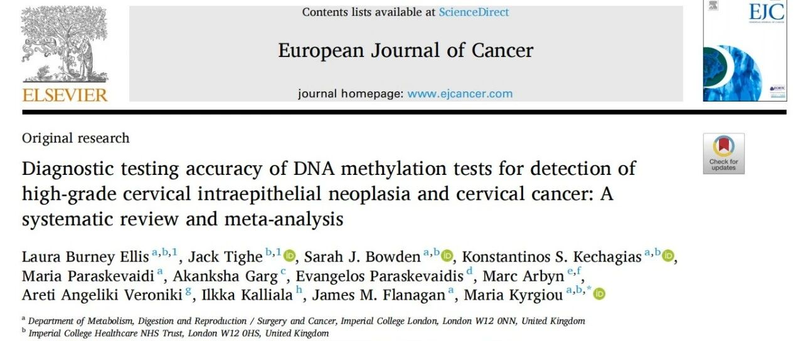
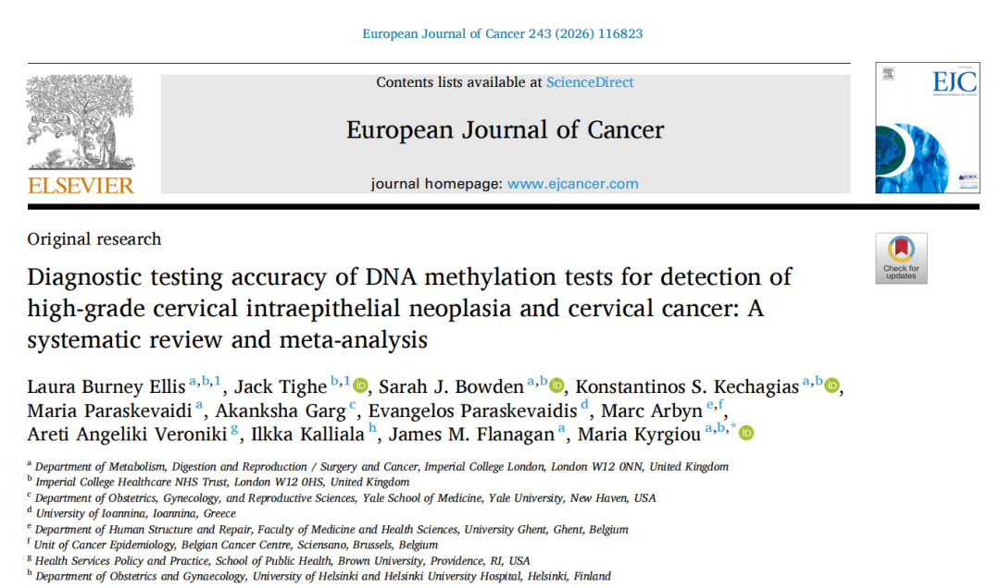

> **Key points**: A systematic review and meta-analysis of 125 studies and 49,242 women (European Journal of Cancer, 2026) compared 32 cervical methylation markers: for CIN3+ detection in HPV-positive populations, JAM3, C13ORF18, and PAX1 ranked top three in overall diagnostic performance; for CIN2+ detection in all-comer populations, the PAX1/JAM3 dual-gene combination achieved the highest diagnostic odds ratio (DOR = 76.00) among all markers. The author team includes Marc Arbyn, lead author of WHO cervical screening guidelines — this meta-analysis will feed into the next WHO/ESGO guideline update.

## What is the PAX1/JAM3 dual-gene methylation test?

The PAX1/JAM3 dual-gene methylation test is an in vitro assay that measures methylation levels in the promoter regions of the PAX1 and JAM3 genes in cervical exfoliated cells, identifying the risk of high-grade cervical lesions (CIN2+/CIN3+) at the epigenetic level. Unlike HPV testing, which looks for the virus, methylation testing directly reflects whether host cells have undergone molecular changes associated with cancer progression. Registration clinical trial data show 89.60% sensitivity and 96.50% specificity for CIN2+ (CISCER, NMPA Reg. No. 20233400253).

## Core findings of this meta-analysis

- **Scale**: 125 studies, 49,242 women, 32 human and HPV-associated methylation markers — among the broadest cervical methylation meta-analyses to date.
- **HPV-positive triage (CIN3+ endpoint)**: Across 51 studies and 28,977 hrHPV-positive women, JAM3, C13ORF18, and PAX1 ranked top three in overall diagnostic performance.
- **All-comer detection (CIN2+ endpoint)**: The PAX1/JAM3 combination, pooling 5 studies and 3,929 participants, achieved a diagnostic odds ratio (DOR) of 76.00 — the highest of all markers compared.
- **Evidence level**: Authors come from Imperial College London, Yale School of Medicine, and the Belgian Cancer Centre, including core WHO/ESGO guideline authors; the conclusions will inform the next international guideline update.

Recently, a systematic review and meta-analysis jointly completed by teams from **Imperial College London (UK), Yale University School of Medicine Department of Obstetrics and Gynecology (USA), Belgian Cancer Centre, Brown University (USA), and Helsinki University Hospital (Finland)**, was published in the *European Journal of Cancer*.

What makes this publication particularly significant: the author group includes **Marc Arbyn (core author of WHO cervical screening guidelines), Maria Kyrgiou, and Laura Burney Ellis**—all EU/WHO guideline-writing experts. **This meta-analysis will serve as part of the evidence base for the next round of WHO/ESGO cervical guideline updates.**

The study included **125 studies and 49,242 women**, systematically comparing the diagnostic performance of 32 human and HPV-related methylation biomarkers. It is one of the most comprehensive cervical methylation meta-analyses to date, providing high-level evidence for the application of methylation detection in cervical cancer screening and triage management.

**I. Findings in Two Core Scenarios**

**① Triage After HPV Positivity (CIN3+ as Endpoint)**

In the analysis of 51 studies involving 28,977 high-risk HPV-positive women, 13 methylation biomarkers were evaluated—**JAM3, C13ORF18, and PAX1** ranked in the top three for overall diagnostic performance. Among these, the JAM3 and PAX1 combination maintained good sensitivity while demonstrating outstanding specificity, enabling more precise identification of high-risk populations requiring colposcopy and histological confirmation, thereby alleviating the current "colposcopy overload" pain point in HPV-positive triage.

**② General Population Regardless of HPV Status (CIN2+ as Endpoint)**

The PAX1/JAM3 dual-target combination pooled data from 5 studies and 3,929 participants, achieving a **diagnostic odds ratio (DOR) of 76.00 for CIN2+ (high-grade precancerous lesions) detection—the highest among all 32 biomarkers/combinations evaluated.**

In other words: **Regardless of HPV status, a "positive signal" from PAX1/JAM3 dual-target highly corresponds to true CIN2+ lesions**—this is critical evidence for advancing methylation detection from "HPV triage adjunct" to "broader clinical use."

**II. Summary**

This meta-analysis, co-authored by international cervical guideline experts, provides evidence at two levels:

· **Single-target level**: PAX1 and JAM3 individually rank in the international first tier for CIN3+ detection in HPV+ populations;

· **Dual-target level**: PAX1/JAM3 achieved the highest comprehensive performance indicator (DOR=76) certified by international guideline experts for CIN2+ detection in the general population.

This systematic review directly positions PAX1 and JAM3 as the globally strongest cervical methylation biomarkers.

The dual-target strategy can, to a certain extent, **reduce variability caused by single-gene methylation heterogeneity**, providing more robust molecular information for cervical lesion risk assessment. It also aligns with the recent WHO/ESGO guideline direction of "precision triage, reducing excessive colposcopy." These conclusions provide guideline-level evidence for the clinical adoption of PAX1/JAM3 dual-target methylation assays and echo the ESGO 2025 CIN2 active surveillance consensus.

**Diagnostic testing accuracy of DNA methylation tests for detection of high-grade cervical intraepithelial neoplasia and cervical cancer: A systematic review and meta-analysis.** European Journal of Cancer, 2026; 243

## Frequently Asked Questions

### What sample does the PAX1/JAM3 methylation test require?

Only cervical exfoliated cells, collected non-invasively during a routine gynecological exam — no biopsy needed. The assay is also compatible with vaginal self-sampling.

### Do I still need methylation testing after HPV vaccination?

Yes. Vaccines prevent infection with specific HPV types but do not affect existing infections or lesions, and they do not cover all high-risk types. Methylation testing assesses the lesion state of the cells themselves, independent of vaccination history.

### What does a positive methylation result mean?

A positive result indicates that cervical cells have undergone molecular changes closely associated with high-grade lesion (CIN2+/CIN3+) progression. It typically prompts colposcopic evaluation. Final clinical decisions should follow medical advice.

### What does a DOR of 76.00 mean?

The diagnostic odds ratio measures how well a test distinguishes lesions from non-lesions — the higher, the better. In this meta-analysis, the PAX1/JAM3 DOR of 76.00 ranked first among all 32 markers compared.

**About CISPOLY**

Beijing Origin-Poly Co., Ltd. is a technology enterprise driven by innovation and committed to health. As a pioneer in the field of early diagnosis of gynecologic tumors, CISPOLY has developed early detection products for cervical cancer, endometrial cancer, ovarian cancer and other gynecologic malignancies based on proprietary technologies and patent-protected biomarkers, filling gaps in this field.

As women's awareness of their own health continues to grow, the women's health market holds tremendous potential. Beyond the gynecologic tumor early screening and diagnosis product line, CISPOLY will continue to establish additional women's health-related product pipelines, striving to become a technology innovation leader in the women's health market.