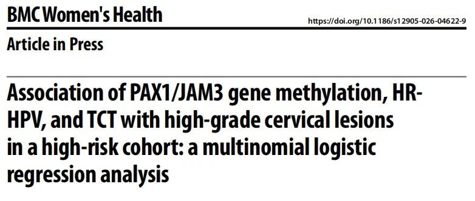
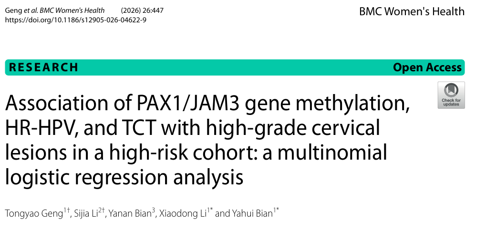

# JAM3甲基化阳性为宫颈癌筛查异常人群带来高级别病变高风险预测

_2026年10月14日 09:54_

河北医科大学第一医院妇科团队在国际期刊《BMC Women's Health》发表题为《Association of PAX1/JAM3 gene methylation, HR-HPV, and TCT with high-grade cervical lesions in a high-risk cohort: a multinomial logistic regression analysis》的研究论文。研究聚焦因筛查异常而转诊阴道镜检查的高风险女性，系统分析高危型人乳头瘤病毒（HR-HPV）、液基细胞学（TCT）及PAX1/JAM3基因甲基化与不同级别宫颈病变之间的关系，旨在寻找能够更准确识别高级别病变的风险分层指标。

## 一、甲基化检测从"筛查异常"中鉴别"病变高危者"

HR-HPV检测敏感度较高，但多数感染具有一过性，仅凭HPV阳性容易增加阴道镜转诊；TCT则依赖专业人员和设备，且在部分病例中难以准确判断病变风险。因此，在传统筛查结果异常后，如何进一步识别真正存在"高级别宫颈病变"的女性，避免阴道镜或活检漏诊，是当前宫颈癌防控中的重要问题。

研究团队入组并分析宫颈癌筛（检）查异常队列：TCT异常、HR-HPV感染或PAX1/JAM3甲基化阳性。研究采用多项Logistic回归，分别分析LSIL和HSIL的独立危险因素，避免了将不同阶段病变简单视为同一线性进展过程，这是本文在统计设计上的重要亮点。

## 二、亮点结果1：JAM3甲基化具更高风险值

多因素分析发现，与炎症组相比，HPV16/18感染可使HSIL风险升高至6.801倍，TCT异常对应的风险为2.399倍。更引人关注的是，PAX1甲基化阳性与HSIL风险升高4.145倍相关，JAM3甲基化阳性对应的风险则达到8.215倍，且二者均为独立相关因素。

双基因甲基化可能并非简单提示"存在任何宫颈异常"，而更倾向于识别已进入高级别阶段的病变。

## 三、亮点结果2：JAM3甲基化阳性表现出较强的HSIL相关性

HPV16/18反映致癌病毒暴露，TCT反映细胞形态异常，而PAX1/JAM3甲基化则提供宿主细胞表观遗传改变的信息。三类指标从不同生物学层面互为补充，特别是JAM3表现出较强的HSIL相关性，为解释"HPV阳性但病变风险不同"的临床现象提供了新的分子证据。

## 四、临床价值：作为异常筛查后的分流工具

研究团队强调，PAX1/JAM3甲基化目前更适合作为HPV或TCT异常后的分流和风险分层工具。对于已转诊阴道镜的人群，将双基因甲基化结果纳入综合判断，有望帮助医生优先识别HSIL高风险患者，推动及时活检和干预；对于风险相对较低者，则可能减少不必要的过度检查和治疗。

上述结果来自单一高风险队列研究，甲基化检测仍需结合HPV分型、细胞学、阴道镜和病理结果综合解释，不能替代医生诊断或病理诊断。

**文献来源**

Geng T., Li S., Bian Y. et al. Association of PAX1/JAM3 gene methylation, HR-HPV, and TCT with high-grade cervical lesions in a high-risk cohort: a multinomial logistic regression analysis. *BMC Women's Health* (2026). [DOI：10.1186/s12905-026-04622-9](https://doi.org/10.1186/s12905-026-04622-9)

**原文链接**

[聚禾生物cispoly：JAM3甲基化阳性为宫颈癌筛查异常人群带来高级别病变高风险预测](https://mp.weixin.qq.com/s/YrgdGUUuTdeI7u3Y5yRcWA)

**关于聚禾生物**

北京起源聚禾生物科技有限公司是以创新科技为驱动、以关注健康为宗旨的科技企业。聚禾生物是妇科肿瘤早诊领域的开拓者，以独家技术和专利保护的标志物为核心，开发了宫颈癌、子宫内膜癌、卵巢癌等妇科肿瘤早诊产品，填补了该领域的空白。

随着女性对自身健康的关注越来越密切，女性健康市场将大有可为，除妇科肿瘤早筛早诊产品线外，未来聚禾生物还将建立更多女性健康相关的产品管线，打造女性健康市场的技术创新型领先企业。
