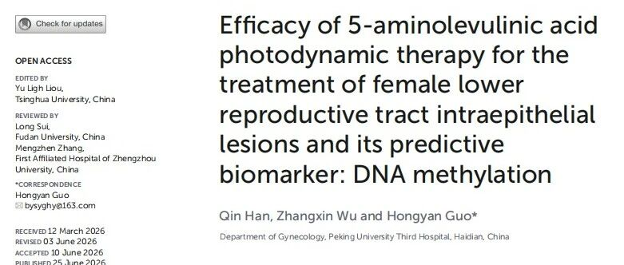
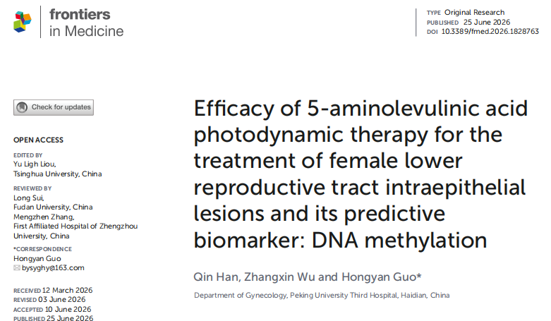

# New Publication | Pre-Treatment Methylation Testing Helps Physicians Judge Whether Photodynamic Therapy Is Right for You—Balancing Efficacy and Fertility Protection

*October 23, 2026, 16:56 (China Standard Time)*

A gynecology team at Peking University Third Hospital recently published a study in the international journal *Frontiers in Medicine*, exploring whether "PAX1/JAM3 dual-gene methylation testing" can help physicians assess, before photodynamic therapy for cervical and vaginal precancerous lesions, whether a patient is a good candidate for photodynamic therapy and how likely the lesion is to regress afterwards.

The study enrolled 516 patients with histologically confirmed high-grade precancerous lesions (CIN2/3 of the cervix and VaIN2/3 of the vagina), who received 5-aminolevulinic acid photodynamic therapy (ALA-PDT). Cervical exfoliated cells were collected at the same time before treatment for methylation testing, and lesion remission was followed up for 6 to 12 months.

## I. Why an "Extra Assessment" Before Treatment?

For high-grade precancerous lesions, conventional conization or LEEP surgery has a well-established effect, but it removes part of the cervical tissue and may carry a risk of preterm birth or functional damage for future pregnancy.

Photodynamic therapy is a minimally invasive approach that does not remove tissue: a photosensitive drug is taken up by the lesion cells and then activated by light of a specific wavelength to clear them, causing comparatively little damage to surrounding normal tissue and the fibrous structure of the cervix. It is therefore especially suitable for young women with fertility needs and for women who require conservative treatment.

There is, however, a clinical reality: among patients receiving the same photodynamic therapy, some lesions regress completely while others persist. In the past, physicians could hardly predict before treatment who would respond well and who might need an intensified course or a switch to surgery. For patients, this is also a difficult choice: pay a substantial amount and travel to hospital repeatedly for a treatment whose outcome cannot be fully anticipated, or proceed directly to conization?

The question this study set out to answer is precisely whether PAX1/JAM3 methylation testing before treatment can help predict the outcome of photodynamic therapy.

## II. Findings: Methylation Status Is Associated with Treatment Response

**1. Patients with "hypomethylation" before treatment had a higher chance of lesion remission after photodynamic therapy**

The analysis showed that patients whose PAX1/JAM3 dual genes presented hypomethylation before treatment achieved a significantly higher proportion of lesion remission after a standard photodynamic therapy course (statistical P < 0.001); conversely, patients with hypermethylation had a relatively higher proportion of persistent lesions after treatment.

**2. Photodynamic therapy performed well overall, but efficacy varied by lesion grade**

The overall remission rates reported in the study were 92.21% for cervical CIN2, 88.68% for cervical CIN3, 78.57% for vaginal VaIN2, and 66.67% for vaginal VaIN3. This indicates that photodynamic therapy is effective for most patients, but the remission rate declines as lesion grade increases.

**3. Methylation shows predictive potential for "whether the lesion persists"**

Using "hypermethylation of either PAX1 or JAM3" as the positive criterion, the study evaluated the ability of the result to predict persistent lesions after treatment. The AUC values (closer to 1 indicates better predictive ability) were 0.861 for CIN2, 0.734 for CIN3, 0.777 for VaIN2, and 0.750 for VaIN3. These data provide preliminary evidence that methylation test results may serve as one reference indicator for assessing likely lesion outcome before treatment.

## III. Practical Significance for Women with Fertility Needs

Choosing the right candidates for photodynamic therapy and avoiding two extremes:

- **Hypomethylation**: a higher chance of benefiting from photodynamic therapy; conservative treatment may be preferred, helping to protect reproductive function.
- **Hypermethylation**: a higher risk of persistent lesions; the physician may suggest an intensified course, more intensive follow-up, or direct consideration of surgery.

The value of this "pre-treatment triage" lies in:

- avoiding blind waiting for patients who are unlikely to respond well to photodynamic therapy, which would delay the optimal window for intervention;
- avoiding immediate surgery for patients who are suitable for conservative treatment, which would cause unnecessary loss of reproductive function or psychological burden.

**A continuous pathway from screening to treatment assessment**

PAX1/JAM3 methylation testing has previously been used for triage after a positive HPV result and for the adjunct identification of CIN2+; this study extends its application further to the prediction of treatment response, forming a continuous decision pathway of "screening → triage → pre-treatment benefit assessment".

## IV. Summary and Reminders

The study suggests that PAX1/JAM3 methylation testing has the potential to serve as a non-invasive adjunct assessment tool before photodynamic therapy, helping physicians make more individualized balancing decisions between "clearing the lesion" and "protecting fertility".

Readers should be reminded that:

- this remains preliminary clinical evidence and cannot yet be used as an absolute basis for deciding a treatment option on its own;
- questions such as the optimal treatment, the cut-off values for outcome interpretation, whether courses need adjustment, and applicability across populations still require validation in larger studies;
- each patient's situation differs, and the final treatment choice should be made by a physician based on a combination of pathology, imaging, fertility plans and other factors.

**Reference**

Han Q., Wu Z., Guo H. Efficacy of 5-aminolevulinic acid photodynamic therapy for the treatment of female lower reproductive tract intraepithelial lesions and its predictive biomarker: DNA methylation. *Frontiers in Medicine* (2026). [DOI: 10.3389/fmed.2026.1828763](https://doi.org/10.3389/fmed.2026.1828763)

**Original article**

[CISPOLY WeChat: Pre-treatment methylation testing helps physicians judge whether photodynamic therapy is right for you](https://mp.weixin.qq.com/s/n03oNhbk1OM_AWDjj--GUw)

**About CISPOLY**

Beijing OriginPoly Bio-Tec Co., Ltd. is a technology company driven by innovation and dedicated to health. CISPOLY is a pioneer in the early diagnosis of gynecological cancers and develops products for early detection of cervical, endometrial, and ovarian cancer based on proprietary technologies and patent-protected biomarkers, filling a gap in this field.

As women pay closer attention to their own health, the women's health market holds great promise. In addition to its early screening and diagnosis product line for gynecological cancers, CISPOLY will continue to build additional women's health product pipelines, striving to become a technology-driven leader in the women's health market.
