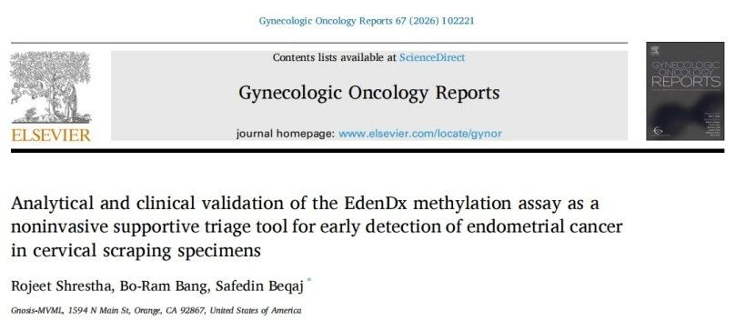

# New Publication | CISPOLY's CDO1/CELF4 Methylation Test Validated in a US Laboratory and Published Internationally, Bringing Noninvasive Endometrial Cancer Screening Overseas

*November 4, 2026, 15:20 (China Standard Time)*

In 2026, CISPOLY authorized INEX Innovate Corp. to localize its endometrial cancer CDO1/CELF4 methylation test in the United States. The US Gnosis-MVML research team has now published the laboratory standardization workflow and clinical validation results in the international gynecologic oncology journal *Gynecologic Oncology Reports*, systematically confirming the analytical performance and clinical diagnostic accuracy of the assay in a US laboratory setting and providing new overseas evidence for the noninvasive, adjunctive detection of endometrial cancer from cervical scraping specimens.

## I. Research Highlights: Strong Performance of CDO1/CELF4 Methylation

**1. High-specificity adjunctive diagnosis that identifies high-risk women**

The study enrolled 80 cervical scraping specimens and found that the CDO1/CELF4 methylation test achieved a diagnostic specificity of 96.8%. This high specificity means the test can effectively distinguish patients who truly need intervention, providing a reliable adjunct for reducing unnecessary invasive procedures such as diagnostic curettage.

**2. Applicable across sample types, with consistent and reliable results**

In 40 formalin-fixed paraffin-embedded tissue samples, sensitivity reached 85.0% and specificity 90.0%, further confirming that CDO1/CELF4 hypermethylation can be effectively identified in both cervical scraping and paraffin-embedded tissue samples, offering flexible sample options for different clinical scenarios.

**3. US laboratory analytical validation fully met requirements**

The team completed a systematic analytical validation in a US laboratory setting:

| Validation item | Key result |
| --- | --- |
| Limit of detection | Cancer cell fractions as low as 1.5% could be identified; at a cancer cell fraction of ≥ 2.5%, the positivity rate was 100% |
| Precision and repeatability | Coefficient of variation (CV) < 10% across batches and operators |
| Interference resistance | Common vaginal pathogens and interfering substances produced no notable effect on results |
| Minimum sample volume and stability | Reliable interpretation maintained at volumes as low as 0.5 mL; simulated samples stored at room temperature for 7 days gave consistent results |

These standardized validation results meet the requirements for CLIA-certified clinical laboratories, providing solid technical support for the CDO1/CELF4 methylation test to enter the US testing market.

## II. Strategic Significance: From Chinese Innovation to the US Market

The validation results indicate that the assay's US laboratory standard is consistent with the standard CISPOLY established in China, and that it shows consistent clinical application potential across different ethnic populations.

As the US market continues to expand, CDO1/CELF4 methylation testing is expected to become an important tool for early identification, risk stratification and adjunctive clinical diagnosis of endometrial cancer in the United States, realizing the precision-medicine vision of "developed in China, shared globally."

## III. Boundaries to Note

Methylation testing is an adjunctive diagnostic and risk-stratification tool. Results cannot replace pathological diagnosis, nor can they serve as the sole basis for deciding on surgery or follow-up; clinical decisions should be made by physicians after comprehensive assessment of imaging, pathology and each patient's individual circumstances.

**Reference**

Shrestha, Rojeet et al. "Analytical and clinical validation of the EdenDx methylation assay as a noninvasive supportive triage tool for early detection of endometrial cancer in cervical scraping specimens." *Gynecologic Oncology Reports*, vol. 67, 102221, 28 Sep. 2026, [DOI: 10.1016/j.gore.2026.102221](https://doi.org/10.1016/j.gore.2026.102221)

**Original article**

[CISPOLY WeChat: New Publication | CISPOLY's CDO1/CELF4 Methylation Test Validated in a US Laboratory and Published Internationally, Bringing Noninvasive Endometrial Cancer Screening Overseas](https://mp.weixin.qq.com/s/QUjgKZKED2PEBiJ1hng3ww)

**About CISPOLY**

Beijing OriginPoly Bio-Tec Co., Ltd. is a technology company driven by innovation and dedicated to health. CISPOLY is a pioneer in the early diagnosis of gynecological cancers and develops products for early detection of cervical, endometrial, and ovarian cancer based on proprietary technologies and patent-protected biomarkers, filling a gap in this field.

As women pay closer attention to their own health, the women's health market holds great promise. In addition to its early screening and diagnosis product line for gynecological cancers, CISPOLY will continue to build additional women's health product pipelines, striving to become a technology-driven leader in the women's health market.
