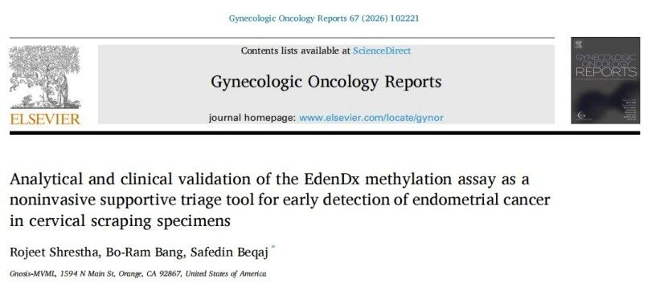

# 新文刊发｜聚禾生物CDO1/CELF4甲基化检测经美国实验室验证发表国际论文，实现子宫内膜癌无创筛查迈向海外

_2026年11月04日 15:20_

2026年，聚禾生物授权 INEX Innovate Corp. 开展子宫内膜癌 CDO1/CELF4 甲基化检测的美国本土化落地。近日，美国 Gnosis-MVML 研究团队将实验室标准化流程与临床验证成果发表于国际妇科肿瘤学期刊《Gynecologic Oncology Reports》，系统证实该检测在美国实验室环境下的分析性能与临床诊断效能，为宫颈脱落细胞无创辅助诊断子宫内膜癌提供了海外循证新依据。

## 一、研究亮点：CDO1/CELF4甲基化展现优异检测性能

**1. 高特异性辅助诊断，精准识别高风险人群**

研究纳入 80 份宫颈脱落细胞样本，结果显示：CDO1/CELF4 甲基化检测诊断特异性高达 96.8%。这一高特异性意味着该检测可有效区分真正需要干预的高风险患者，为减少不必要的侵入性检查（如诊断性刮宫）提供可靠的辅助决策依据。

**2. 多样本类型适用，验证结果一致可靠**

在 40 份石蜡包埋组织样本中，检测敏感性达 85.0%，特异性达 90.0%，进一步证实 CDO1/CELF4 甲基化异常可在宫颈脱落细胞与组织蜡块样本中均被有效识别，为不同临床场景下的样本应用提供了灵活选择。

**3. 美国实验室方法学验证全面达标**

研究团队在美国实验室环境下完成了系统性的分析性能验证：

| 验证项目 | 关键结果 |
| --- | --- |
| 最低检出限 | 可识别癌细胞比例低至 1.5% 的样本；癌细胞比例 ≥ 2.5% 时，阳性率达 100% |
| 精密度与重复性 | 不同批次及操作人员间变异系数（CV）均 < 10% |
| 抗干扰能力 | 常见阴道病原体及干扰物质未对检测结果产生明显影响 |
| 最低样本量与稳定性 | 样本体积低至 0.5 mL 仍保持稳定判读；模拟样本室温保存 7 天结果一致 |

上述标准化验证结果符合 CLIA 认证临床实验室规范要求，为 CDO1/CELF4 甲基化检测进入美国检测市场提供了坚实的技术支撑。

## 二、战略意义：从中国创新到美国市场的跨越

本研究从检测验证结果表明，该检测的美国实验室标准与聚禾生物国内建立的标准具有一致性，且对不同人种群体同样展现一致的临床应用潜力。

未来，随着美国市场的持续拓展，CDO1/CELF4 甲基化检测有望成为美国子宫内膜癌早期识别、风险分层和临床辅助诊断的重要工具，真正实现"中国原研、全球共享"的精准医疗愿景。

## 三、需要说明的边界

甲基化检测是辅助诊断与风险分层工具，检测结果不能替代病理诊断，也不能作为单一依据决定是否手术或随访方案；具体临床决策仍需由医师结合影像、病理与个体情况综合判断。

**文献来源**

Shrestha, Rojeet et al. "Analytical and clinical validation of the EdenDx methylation assay as a noninvasive supportive triage tool for early detection of endometrial cancer in cervical scraping specimens." *Gynecologic Oncology Reports*, vol. 67, 102221, 28 Sep. 2026, [DOI：10.1016/j.gore.2026.102221](https://doi.org/10.1016/j.gore.2026.102221)

**原文链接**

[聚禾生物cispoly：新文刊发｜聚禾生物CDO1/CELF4甲基化检测经美国实验室验证发表国际论文，实现子宫内膜癌无创筛查迈向海外](https://mp.weixin.qq.com/s/QUjgKZKED2PEBiJ1hng3ww)

**关于聚禾生物**

北京起源聚禾生物科技有限公司是以创新科技为驱动、以关注健康为宗旨的科技企业。聚禾生物是妇科肿瘤早诊领域的开拓者，以独家技术和专利保护的标志物为核心，开发了宫颈癌、子宫内膜癌、卵巢癌等妇科肿瘤早诊产品，填补了该领域的空白。

随着女性对自身健康的关注越来越密切，女性健康市场将大有可为，除妇科肿瘤早筛早诊产品线外，未来聚禾生物还将建立更多女性健康相关的产品管线，打造女性健康市场的技术创新型领先企业。
