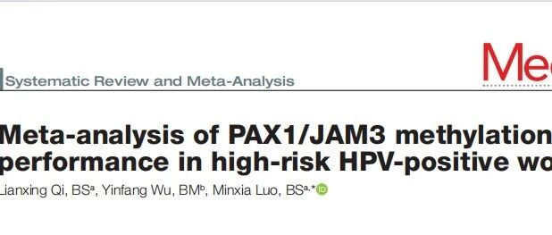
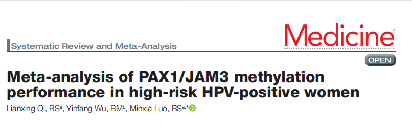

# New Publication | PAX1/JAM3 (CISCER®) Dual-Gene Methylation Meta-analysis: New Evidence for Triage in HR-HPV-Positive Women

*November 12, 2026, 15:02 (China Standard Time)*

The Laboratory Medicine and Gynecology teams of Shaoxing Shangyu Maternal and Child Health Hospital have published a meta-analysis titled "Meta-analysis of PAX1/JAM3 methylation performance in high-risk HPV-positive women" in *Medicine*, pooling 8 studies and 7,494 participants to evaluate the diagnostic performance of PAX1/JAM3 dual-gene methylation testing for high-grade cervical lesions.

## I. Study Overview

- **Included studies**: 8 studies covering 7,494 HR-HPV-positive or screening populations;
- **Reference standard**: histopathology (CIN2+ / CIN3+);
- **Methodology**: study quality assessed with QUADAS-2; pooled sensitivity, specificity and AUC calculated with Meta-Disc 1.4 and Stata 17.

## II. Key Results

| Diagnostic endpoint | Pooled sensitivity | Pooled specificity | AUC |
| --- | --- | --- | --- |
| CIN2+ lesions | 81% | 95% | 0.96 |
| CIN3+ lesions | 85% | 88% | 0.90 |

In subgroup analysis, CIN2+ sensitivity was higher in prospective studies (90%) than in retrospective studies (72%), while specificity was 95% in both groups; results remained stable after excluding any single study in the sensitivity analysis.

## III. What This Means for Gynecologic Practice

HR-HPV positivity does not equal the presence of a high-grade lesion. Cytology is the current routine triage approach, but specimen collection and interpretation can make decisions difficult in low-grade abnormalities or ASC-US.

This meta-analysis shows that PAX1/JAM3 dual-gene methylation achieves 95% specificity for CIN2+ detection. Its clinical value lies mainly in three areas:

1. **Higher priority for positives**: with both methylation and HPV positivity, colposcopy and biopsy should be scheduled more actively, reducing the chance that high-grade lesions are missed.
2. **Fewer unnecessary referrals for negatives**: low-risk combinations (HPV non-16/18 positive, methylation negative, no HSIL on cytology) may be considered for guideline-based follow-up, avoiding unnecessary colposcopy.
3. **An objective marker to complement cytology**: methylation results are less affected by subjective interpretation and can serve as a molecular adjunct for secondary triage after HPV positivity.

> **Please note**: this is a meta-analysis. Its conclusions support the triage potential of PAX1/JAM3 dual-gene methylation and are not equivalent to a single-center diagnostic standard; cut-offs should still follow the product instructions and local validation. Test results cannot replace pathological diagnosis, and clinical decisions should be made by physicians after comprehensive assessment of cytology, colposcopy and pathology findings.

## IV. Summary

In HR-HPV-positive women, PAX1/JAM3 dual-gene methylation shows high diagnostic accuracy for both CIN2+ and CIN3+, with particularly strong specificity, making it suitable as an adjunctive tool for cervical lesion risk stratification and colposcopy referral decisions.

**Publication**

Wu Y, Qi L, Luo M. Meta-analysis of PAX1/JAM3 methylation performance in high-risk HPV-positive women. *Medicine*. 2026;105(38):e50757. [DOI: 10.1097/MD.0000000000050757](https://doi.org/10.1097/MD.0000000000050757)

**Original article**

[CISPOLY WeChat: New Publication | PAX1/JAM3 (CISCER®) Dual-Gene Methylation Meta-analysis: New Evidence for Triage in HR-HPV-Positive Women](https://mp.weixin.qq.com/s/VYHpf3pFcA6kLztjFMXsrg)

**About CISPOLY**

Beijing OriginPoly Bio-Tec Co., Ltd. is a technology company driven by innovation and dedicated to health. CISPOLY is a pioneer in the early diagnosis of gynecological cancers and develops products for early detection of cervical, endometrial, and ovarian cancer based on proprietary technologies and patent-protected biomarkers, filling a gap in this field.

As women pay closer attention to their own health, the women's health market holds great promise. In addition to its early screening and diagnosis product line for gynecological cancers, CISPOLY will continue to build additional women's health product pipelines, striving to become a technology-driven leader in the women's health market.
