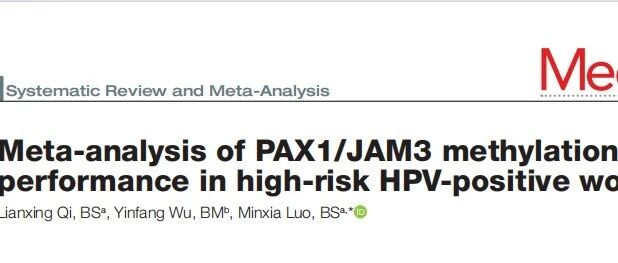
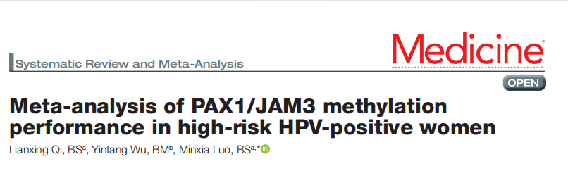

# 新文刊发｜PAX1/JAM3（CISCER®）双基因甲基化 Meta 分析：HR-HPV 阳性人群分流的新循证证据

_2026年11月12日 15:02_

近日，绍兴市上虞妇幼保健院检验科与妇科团队在 *Medicine* 发表题为《Meta-analysis of PAX1/JAM3 methylation performance in high-risk HPV-positive women》的 Meta 分析，汇总 8 项研究、7,494 名受试者数据，评估 PAX1/JAM3 双基因甲基化检测对宫颈高级别病变的诊断效能。

## 一、研究要点

- **纳入研究**：8 项研究，7,494 例 HR-HPV 阳性或筛查人群；
- **参考标准**：组织病理学结果（CIN2+ / CIN3+）；
- **方法学**：采用 QUADAS-2 进行文献质量评价，使用 Meta-Disc 1.4 与 Stata 17 合并敏感度、特异度与 AUC。

## 二、主要结果

| 诊断终点 | 合并敏感度 | 合并特异度 | AUC |
| --- | --- | --- | --- |
| CIN2+ 病变 | 81% | 95% | 0.96 |
| CIN3+ 病变 | 85% | 88% | 0.90 |

亚组分析中，前瞻性研究的 CIN2+ 敏感度（90%）高于回顾性研究（72%），特异度两组均为 95%；敏感性分析排除单一研究后结果稳定。

## 三、对妇科临床的意义

HR-HPV 阳性不等于存在高级别病变。当前临床常用细胞学做分流，但受取材与判读影响，在低级别病变或 ASC-US 时，决策并不轻松。

本 Meta 分析显示，PAX1/JAM3 双基因甲基化在 CIN2+ 检测中特异度达 95%，其临床价值主要体现在三个方面：

1. **阳性者优先级提高**：甲基化阳性 + HPV 阳性，建议更积极安排阴道镜与活检，降低高级别病变可能漏诊。
2. **阴性者减少过度转诊**：低危组合（HPV 非 16/18 阳性、甲基化阴性、细胞学无 HSIL 提示）可考虑按规范随访，减少不必要的阴道镜。
3. **客观指标补充细胞学**：甲基化结果受人为判读影响较小，可作为 HPV 阳性后二次分流的分子补充。

> **需注意**：本研究为 Meta 分析，结论支持 PAX1/JAM3 双基因甲基化的「分流潜力」，不直接等同于单中心确诊标准；临界值仍建议结合产品说明书与本机构验证情况使用。检测结果不能替代病理诊断，具体临床决策仍需由医师结合细胞学、阴道镜与病理结果综合判断。

## 四、小结

PAX1/JAM3 双基因甲基化在 HR-HPV 阳性女性中，对 CIN2+ 与 CIN3+ 均显示较高诊断准确性，尤其特异度表现突出，适合作为宫颈病变风险分层与阴道镜转诊决策的辅助工具。

**论文信息**

Wu Y, Qi L, Luo M. Meta-analysis of PAX1/JAM3 methylation performance in high-risk HPV-positive women. *Medicine*. 2026;105(38):e50757. [DOI: 10.1097/MD.0000000000050757](https://doi.org/10.1097/MD.0000000000050757)

**原文链接**

[聚禾生物cispoly：新文刊发｜PAX1/JAM3 (CISCER®) 双基因甲基化Meta分析：HR-HPV阳性人群分流的新循证证据](https://mp.weixin.qq.com/s/VYHpf3pFcA6kLztjFMXsrg)

**关于聚禾生物**

北京起源聚禾生物科技有限公司是以创新科技为驱动、以关注健康为宗旨的科技企业。聚禾生物是妇科肿瘤早诊领域的开拓者，以独家技术和专利保护的标志物为核心，开发了宫颈癌、子宫内膜癌、卵巢癌等妇科肿瘤早诊产品，填补了该领域的空白。

随着女性对自身健康的关注越来越密切，女性健康市场将大有可为，除妇科肿瘤早筛早诊产品线外，未来聚禾生物还将建立更多女性健康相关的产品管线，打造女性健康市场的技术创新型领先企业。
