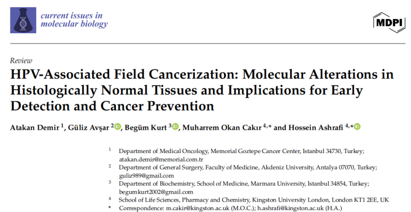

# New Publication | From HPV Infection to Cancer Risk Assessment: DNA Methylation Offers a New Perspective on Precision Cervical Cancer Screening

*November 19, 2026, 16:10 (China Standard Time)*

In September 2026, the research team led by Atakan Demir published a review titled "HPV-Associated Field Cancerization: Molecular Alterations in Histologically Normal Tissues and Implications for Early Detection and Cancer Prevention" in the international journal *Current Issues in Molecular Biology*. The review maps the molecular alterations of HPV-associated field cancerization in histologically normal tissues, and highlights the clinical potential of DNA methylation in early risk identification, precancerous lesion stratification and precision screening of cervical cancer, offering a new perspective for the early prevention and control of HPV-related tumors.

## I. From HPV Infection to Precancerous Lesions: Methylation Reveals Early Molecular Changes

Cervical cancer usually develops through persistent HPV infection, cervical intraepithelial neoplasia and invasive cancer. However, a histologically normal appearance does not mean that no molecular abnormality has occurred at the cellular level.

From the perspective of "field cancerization," the review points out that HPV-associated molecular alterations may extend beyond the visible lesion and be present in some histologically normal epithelial tissues.

DNA methylation is one of the earliest epigenetic changes in HPV-associated carcinogenesis and one with screening potential. Because it is relatively stable and can be measured quantitatively, methylation may help identify molecular risks that conventional morphological examination cannot easily capture.

A prospective study cited in the review found that elevated HPV16 DNA methylation levels in cervical samples were associated with the subsequent development of CIN3. In addition, methylation studies of cervical and anal carcinogenesis identified 17 commonly hypermethylated genes and were able to divide some high-grade intraepithelial lesions into subtypes with distinct molecular features.

These findings suggest that lesions at the same pathological grade may still differ at the molecular level, and that methylation testing may add information for cancer risk assessment.

## II. From HPV Positivity to Precision Triage: Methylation Shows Clinical Value

HPV testing is an important tool in cervical cancer screening, but HPV positivity does not mean that a high-grade lesion has already developed. Identifying the women who truly need close attention and clinical intervention is the key to making screening more precise.

The review summarizes the evidence for the use of various methylation markers in triaging HPV-positive women. This evidence indicates that methylation testing not only provides molecular information related to lesion severity, but may also help further stratify HPV-positive women, supporting colposcopy referral and subsequent clinical management.

### From lesion detection to post-treatment management: further application scenarios for methylation

Beyond primary triage, methylation may also play a role in the long-term management of cervical precancerous lesions. By dynamically monitoring specific methylation markers and combining them with persistent HPV infection status, pathological results and other clinical indicators, more refined post-treatment risk assessment approaches may be explored.

## III. Summary and Outlook

DNA methylation already has a relatively solid base of clinical validation for risk stratification and screening triage in HPV-positive women, and may be further extended to precancerous lesion management and post-treatment surveillance.

> **Please note**: this review discusses the potential for molecular-level risk identification. Methylation results are supplementary information for risk assessment and cannot replace cytology, colposcopy or histopathological diagnosis; screening and follow-up plans should still be determined by physicians based on the individual situation.

**Reference**

Demir A, Avşar G, Kurt B, Cakır M O, Ashrafi H. HPV-Associated Field Cancerization: Molecular Alterations in Histologically Normal Tissues and Implications for Early Detection and Cancer Prevention. *Current Issues in Molecular Biology*. 2026;48(9):932. [DOI: 10.3390/cimb48090932](https://doi.org/10.3390/cimb48090932)

**Original article**

[CISPOLY WeChat: New Publication | From HPV Infection to Cancer Risk Assessment: DNA Methylation Offers a New Perspective on Precision Cervical Cancer Screening](https://mp.weixin.qq.com/s/qdDjnBLcrSfSaGj4XXDFSg)

**About CISPOLY**

Beijing OriginPoly Bio-Tec Co., Ltd. is a technology company driven by innovation and dedicated to health. CISPOLY is a pioneer in the early diagnosis of gynecological cancers and develops products for early detection of cervical, endometrial, and ovarian cancer based on proprietary technologies and patent-protected biomarkers, filling a gap in this field.

As women pay closer attention to their own health, the women's health market holds great promise. In addition to its early screening and diagnosis product line for gynecological cancers, CISPOLY will continue to build additional women's health product pipelines, striving to become a technology-driven leader in the women's health market.
