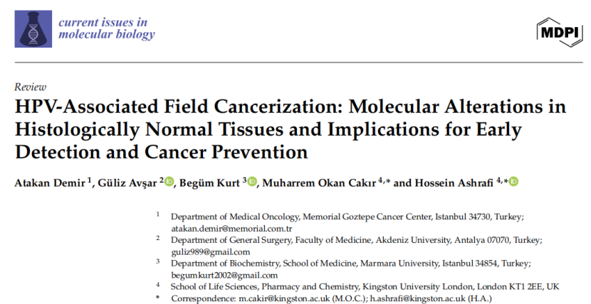
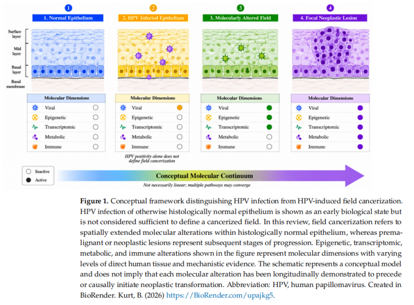

# 新文刊发｜从 HPV 感染识别到癌变风险评估：DNA 甲基化为宫颈癌精准筛查提供新视角

_2026年11月19日 16:10_

2026 年 9 月，Atakan Demir 等研究团队在国际学术期刊 *Current Issues in Molecular Biology* 发表题为《HPV-Associated Field Cancerization: Molecular Alterations in Histologically Normal Tissues and Implications for Early Detection and Cancer Prevention》的综述。文章系统梳理了 HPV 相关「区域癌化」在组织学正常组织中的分子改变，重点揭示 DNA 甲基化在宫颈癌早期风险识别、癌前病变分层及精准筛查中的临床应用潜力，为 HPV 相关肿瘤的早期防控提供了新的研究视角。

## 一、从 HPV 感染到癌前病变：甲基化揭示早期分子改变

宫颈癌的发生通常经历 HPV 持续感染、宫颈上皮内瘤变及浸润性癌等阶段。然而，组织学表现正常，并不意味着细胞尚未发生分子层面的异常。

该综述从「区域癌化」（Field Cancerization）的角度指出，HPV 相关分子改变可能超出可见病灶的范围，存在于部分组织学正常的上皮组织中。

DNA 甲基化是 HPV 相关癌变过程中较早出现且具有检测潜力的表观遗传改变之一。由于其相对稳定、可定量分析，甲基化有望帮助识别传统形态学检查难以反映的分子风险。

综述引用的前瞻性研究发现，宫颈样本中 HPV16 DNA 甲基化水平升高与后续发生 CIN3 相关。此外，宫颈和肛管癌变过程中的甲基化研究识别出 17 个共同的高甲基化基因，并可将部分高级别上皮内病变区分为具有不同分子特征的亚型。

这些发现提示，即使病理分级相同，不同病变也可能存在分子异质性，甲基化检测有望为癌变风险评估提供补充信息。

## 二、从 HPV 阳性到精准分流：甲基化展现临床应用价值

HPV 检测是宫颈癌筛查的重要手段，但 HPV 阳性并不意味着已经发生高级别病变。如何进一步识别真正需要密切关注和临床干预的人群，是提高筛查精准度的关键。

综述重点总结了多种甲基化标志物在 HPV 阳性人群分流中的应用证据。这些证据表明，甲基化检测不仅能够提供与病变严重程度有关的分子信息，还有望帮助 HPV 阳性女性进一步分层，为阴道镜转诊及后续临床管理提供辅助依据。

### 从病变识别到治疗后管理：进一步拓展甲基化应用场景

除初筛分流外，甲基化还可能在宫颈癌前病变的长期管理中发挥作用。通过动态监测特定甲基化标志物，并结合 HPV 持续感染状态、病理结果及其他临床指标，有望探索更精细化的术后风险评估方法。

## 三、总结与展望

DNA 甲基化在 HPV 阳性女性的风险分层与筛查分流方面已具有较为充分的临床验证基础，并有望进一步拓展至癌前病变管理和治疗后监测。

> **需注意**：本综述讨论的是分子层面的风险识别潜力。甲基化检测结果是风险评估的补充信息，不能替代细胞学、阴道镜与组织病理学诊断；具体筛查与随访方案仍需由医师结合个体情况综合判断。

**参考文献**

Demir A, Avşar G, Kurt B, Cakır M O, Ashrafi H. HPV-Associated Field Cancerization: Molecular Alterations in Histologically Normal Tissues and Implications for Early Detection and Cancer Prevention. *Current Issues in Molecular Biology*. 2026;48(9):932. [DOI: 10.3390/cimb48090932](https://doi.org/10.3390/cimb48090932)

**原文链接**

[聚禾生物cispoly：新文刊发｜从HPV感染识别到癌变风险评估：DNA甲基化为宫颈癌精准筛查提供新视角](https://mp.weixin.qq.com/s/qdDjnBLcrSfSaGj4XXDFSg)

**关于聚禾生物**

北京起源聚禾生物科技有限公司是以创新科技为驱动、以关注健康为宗旨的科技企业。聚禾生物是妇科肿瘤早诊领域的开拓者，以独家技术和专利保护的标志物为核心，开发了宫颈癌、子宫内膜癌、卵巢癌等妇科肿瘤早诊产品，填补了该领域的空白。

随着女性对自身健康的关注越来越密切，女性健康市场将大有可为，除妇科肿瘤早筛早诊产品线外，未来聚禾生物还将建立更多女性健康相关的产品管线，打造女性健康市场的技术创新型领先企业。
